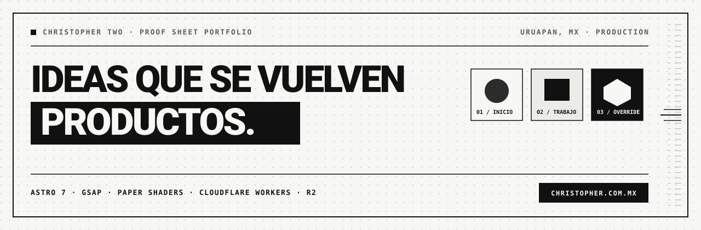
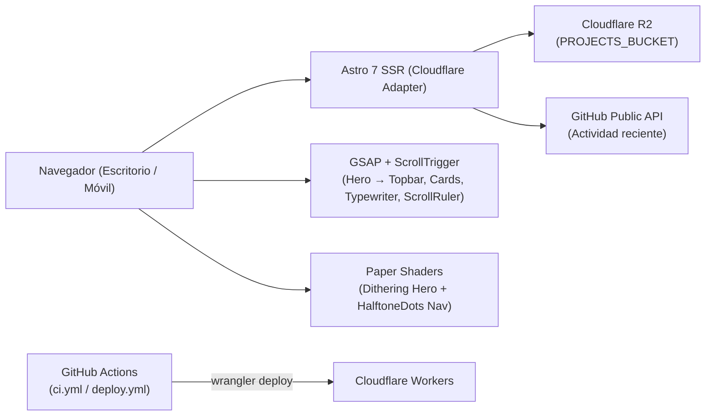

<div align="center">



<br />
<br />

[](https://www.christopher.com.mx)
[](https://github.com/christopher-two/christopher-portfolio/actions/workflows/deploy.yml)
[](https://astro.build)
[](https://gsap.com)
[](https://workers.cloudflare.com)
[](LICENSE)

<br />

**[Explorar en vivo](https://www.christopher.com.mx/landing)** · **[Proyectos](https://www.christopher.com.mx/projects)** · **[Biografía](https://www.christopher.com.mx/bio)** · **[Override](https://www.christopher.com.mx/override)** · **[Contacto](mailto:hola@christopher.com.mx)**

</div>

---

## Visión general

Portfolio profesional de **Christopher Alejandro Maldonado Chávez (Christopher Two)**, desarrollador multiplataforma en Uruapan, Michoacán, México. Diseñado con estética editorial monocromática (*Monochrome Proof Sheet*), enfocado en productos reales que llegan a producción en **Kotlin Multiplatform**, **Android**, **Web** e **IA**.

## Arquitectura y flujo



## Características principales

| Capacidad | Implementación | Archivo |
| --- | --- | --- |
| **Hero → Topbar con Dithering** | En escritorio (`>= 1024px`), las tarjetas cuadradas de navegación en el hero se encogen con **GSAP ScrollTrigger** hasta acoplarse en la topbar sobre una trama dithering; los paneles desplegables se activan solo al acoplarse arriba. | [Header.astro](src/components/Header.astro) |
| **Imágenes Halftone en Navegación** | Cada sección (`Inicio`, `Trabajo`, `Sobre mí`, `Override`, `Contacto`) procesa su miniatura en tiempo real mediante `@paper-design/shaders-react` (`HalftoneDots`) sincronizado con el tema claro/oscuro. | [NavCardDots.tsx](src/components/NavCardDots.tsx) |
| **Fondo Dithering en Hero** | Campo monocromático `Dithering` de Paper Shaders encapsulado en el hero con respuesta al scroll. | [HeroShader.tsx](src/components/HeroShader.tsx) |
| **Barra de Scroll tipo Regla** | Regla fija vertical con 72 marcas reactivas a posición de scroll y cursor mediante `gsap.quickTo` + `mix-blend-mode: difference`. | [ScrollRuler.tsx](src/components/ScrollRuler.tsx) |
| **Tipografía Typewriter y Cards** | Escritura letra por letra en encabezados y reducción progresiva de cards con imagen en `.projects-grid` vía GSAP. | [MotionEnhancer.tsx](src/components/MotionEnhancer.tsx) |
| **Menú Móvil Flotante** | Botón flotante inferior derecho que despliega un menú a pantalla completa con iconos SVG y selector de tema integrado. | [global.css](src/styles/global.css) |
| **Galería Dinámica R2** | Carga de portadas y galerías multimedia desde Cloudflare R2 (`PROJECTS_BUCKET`) con visor modal y soporte de video. | [r2.ts](src/lib/r2.ts) |

## Stack tecnológico

| Capa | Tecnologías |
| --- | --- |
| **Framework y UI** | Astro 7 (`output: "server"`), React 19, TypeScript 5.9, CSS nativo (tokens monocromáticos `White` / `Black`) |
| **Animación y Shaders** | GSAP (`ScrollTrigger`), Motion, `@paper-design/shaders-react` (`Dithering`, `HalftoneDots`) |
| **Edge y Almacenamiento** | Cloudflare Workers (`@astrojs/cloudflare`), Cloudflare R2, Wrangler v4 |
| **SEO y Descubribilidad** | JSON-LD (`ProfilePage`, `SoftwareApplication`, `FAQPage`), `sitemap.xml`, `robots.txt`, `llms.txt`, `llms-full.txt` |

## Rutas principales

| Ruta | Descripción |
| --- | --- |
| `/landing` | Página principal con hero editorial, selección de proyectos en grid, principios, FAQ, apps publicadas y actividad de GitHub |
| `/projects` | Catálogo completo con filtros por tecnología y portadas dinámicas |
| `/projects/[slug]` | Case study individual con galería multimedia desde Cloudflare R2 |
| `/projects/resume` | Resumen técnico imprimible / exportable a PDF |
| `/bio` | Trayectoria profesional, metas y enfoque de ingeniería |
| `/override` · `/parse` · `/spot` · `/daelia` · `/lumi` | Páginas de marca, productos y documentación legal (`/spot/privacy`, `/spot/terms`, `/spot/versions`) |

## Productos publicados en Google Play

| Producto | Descripción | Enlace |
| --- | --- | --- |
| **Parse** | Lector de libros y PDFs para Android con traducción inteligente | [Google Play](https://play.google.com/store/apps/details?id=org.christophertwo.parse) |
| **Helix** | Monitor de sistema para Android con métricas en tiempo real | [Google Play](https://play.google.com/store/apps/details?id=org.override.system.monitor) |
| **Jukskani** | Plataforma inmobiliaria multiplataforma para asesores y compradores | [Google Play](https://play.google.com/store/apps/details?id=org.override.eje.android) |

## Estructura del proyecto

```text
.
├── .github/workflows/       # CI (pull requests) y Deploy directo a Cloudflare Workers
├── docs/                    # Recursos visuales y blueprint
├── src/
│   ├── assets/images/       # Imagen de perfil y activos estáticos
│   ├── components/          # Header, Footer, HeroShader, NavCardDots, ScrollRuler, MotionEnhancer, ProjectCard
│   ├── content/spot/        # Documentación legal y versiones de Spot (Markdown)
│   ├── data/                # Configuración del sitio, rutas, SEO y catálogo curado
│   ├── features/            # Contenido y repositorios por dominio (bio, home, projects, brand-pages, spot)
│   ├── layouts/             # BaseLayout con metadatos OpenGraph y Schema.org
│   ├── lib/                 # Datos de proyectos, cliente GitHub y utilidades R2
│   ├── pages/               # Rutas SSR, API proxy R2 (/api/r2-image) y endpoints SEO
│   └── styles/              # Sistema de diseño monocromático en CSS nativo
├── astro.config.ts
├── wrangler.jsonc
└── package.json
```

## Desarrollo local

Requisitos: **Node.js >= 22** y **pnpm**.

```bash
git clone git@github.com:christopher-two/christopher-portfolio.git
cd christopher-portfolio
pnpm install
pnpm dev
```

El servidor de desarrollo queda disponible en `http://localhost:9002`.

| Comando | Descripción |
| --- | --- |
| `pnpm dev` | Genera tipos de Wrangler e inicia Astro en el puerto `9002` |
| `pnpm check` | Ejecuta `wrangler types` y `astro check` |
| `pnpm build` | Verifica tipos y compila el worker para producción en `dist/` |
| `pnpm preview` | Previsualiza el build compilado |
| `pnpm deploy` | Compila y despliega directamente a Cloudflare Workers |

## Despliegue automático (GitHub Actions)

Cada `push` a `main` ejecuta [`.github/workflows/deploy.yml`](.github/workflows/deploy.yml) y publica en Cloudflare Workers. Para habilitarlo en un fork o nuevo entorno, define en **Settings → Secrets and variables → Actions**:

- `CLOUDFLARE_API_TOKEN` *(requerido)*: token con permisos de despliegue en Cloudflare Workers.
- `CLOUDFLARE_ACCOUNT_ID` *(opcional)*: identificador de la cuenta cuando el token tiene acceso a múltiples cuentas.

## Documentación adicional y comunidad

- [CONTRIBUTING.md](CONTRIBUTING.md) — Guía para colaborar y verificar cambios
- [SECURITY.md](SECURITY.md) — Reporte responsable de vulnerabilidades
- [CODE_OF_CONDUCT.md](CODE_OF_CONDUCT.md) — Código de conducta
- [DESIGN.md](DESIGN.md) y [PRODUCT.md](PRODUCT.md) — Sistema de diseño y principios de producto
- [LICENSE](LICENSE) — Licencia MIT

## Contacto

- **Web:** [christopher.com.mx](https://www.christopher.com.mx)
- **Correo:** [hola@christopher.com.mx](mailto:hola@christopher.com.mx)
- **GitHub:** [@christopher-two](https://github.com/christopher-two)
- **LinkedIn:** [christopher-two](https://www.linkedin.com/in/christopher-two/)
